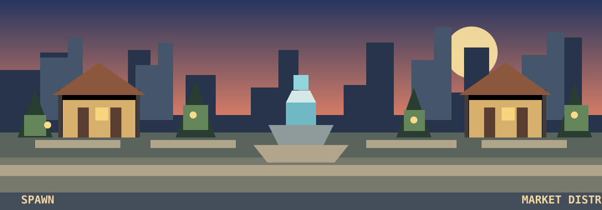
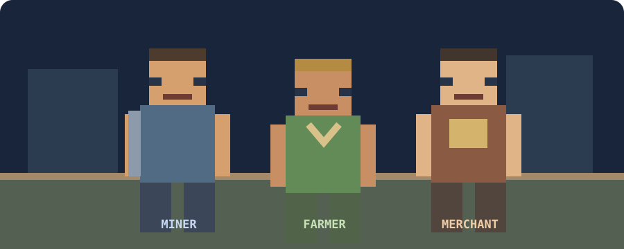

# NOSTALGIA SMP

A Bedrock-first, single-player Economy SMP simulation inspired by the 2012–2016 Minecraft multiplayer server era.

The player enters a persistent survival world populated by simulated competitors with player-style identities. These agents gather and trade resources, negotiate deals, compete in the market, accumulate wealth and participate in a shared economy.

*The visual direction: a familiar old-school spawn hub, with the marketplace as the social and economic centre.*

*Miner, farmer and merchant are the first planned agent roles. These are concept illustrations, not in-game screenshots or implemented assets.*

> **Status:** Planning / pre-implementation. This repository contains the product specification, architecture decisions, open questions and roadmap. No working gameplay systems are claimed yet.

## Product pillars

1. **Living economy:** one authoritative currency, inventory and transaction system shared by the player, simulated agents, shops, crates and casino.
2. **Player-like competitors:** named humanoid characters with player-style skins, professions, inventories, personalities and persistent profiles.
3. **Real market behaviour:** listings, offers, counter-offers, buying, selling and price competition between agents.
4. **Classic server loop:** physical spawn marketplace, remote shop access at less favourable prices, crates, gambling and competitive rankings.
5. **Single-player balance:** the simulated population supplies demand and competition without requiring other human players.
6. **Offline progression:** economic activity is simulated when the world is reopened; the project does not depend on entities remaining loaded while the game is closed.

## Confirmed design decisions

| Area | Decision |
|---|---|
| Platform | Minecraft Bedrock first |
| Primary experience | Single-player Economy SMP |
| Bot appearance | Player-style skins / humanoid presentation |
| Bot interaction | In-world chat and interaction plus menus |
| Trading | Listings, offers, negotiation and bot-vs-bot competition |
| Shops | Remote shop and physical spawn shop; physical shop offers better prices |
| Crates | Common, Rare and Legendary keys with weighted random rewards |
| Gambling | Risk-based wagers against simulated players |
| Competition | Wealth leaderboard and market dominance |
| Economy difficulty | Classic grind with competitive market pressure |
| Offline activity | Economic simulation continues while player is away |
| First bot implementation | Custom player-style entity |
| Experimental alternative | SimulatedPlayer isolated behind an experiment / feature branch |
| Development approach | Bedrock add-on, TypeScript and version-pinned Script API |
| First milestone | Economy foundation before bots, crates or casino |

## Important terminology

Simulated competitors are **not real connected Minecraft accounts**. The initial implementation uses custom entities and scripted profiles to represent players. Their names, appearance, inventories, money and decisions are simulated by the add-on.

The experimental Bedrock SimulatedPlayer API may provide a more authentic player presence, but it has beta/API compatibility and lifecycle constraints. It must not be a dependency of the stable first release.

## Documentation

- [Project plan](docs/PROJECT_PLAN.md)
- [Technical architecture](docs/TECHNICAL_ARCHITECTURE.md)
- [Roadmap and acceptance criteria](docs/ROADMAP.md)
- [Open questions and assumptions](docs/OPEN_QUESTIONS.md)
- [Reference and licensing policy](docs/REFERENCE_POLICY.md)

## Initial implementation scope

The first playable milestone is deliberately small:

- One authoritative currency and transaction ledger.
- Player balance and inventory ownership checks.
- A physical spawn shop and a remote shop interface.
- Five visible simulated competitors.
- Three initial professions: miner, farmer and merchant.
- Basic agent profiles and player-facing trade offers.
- Persistent state across world reloads.
- A bounded, deterministic offline catch-up simulation.

The first milestone does **not** include a complete casino, crates, factions, ranks, kits, large populations or fully autonomous pathfinding.

## Development principles

- Correctness before feature count.
- One source of truth for balances and item ownership.
- No free money, duplicated items or unaccounted trades.
- Fail closed when state is missing or invalid.
- Keep beta-only APIs out of the stable path.
- Test on the target Bedrock client after each phase.
- Treat third-party projects as references unless their licence explicitly permits reuse.
- Do not spend Minecoins on add-ons until a specific, tested gap is identified.

## Status

This repository is currently a planning baseline. Technical package versions, target Minecraft version, device test matrix, persistence limits and UI library compatibility must be verified before the implementation scaffold is committed.
