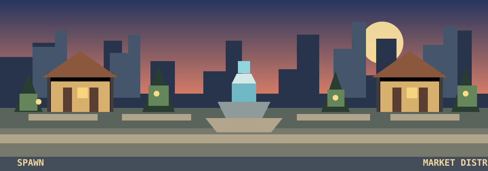

# NOSTALGIA SMP — Roadmap

**Status:** Proposed sequence; no phase is complete yet.

## Delivery strategy

Build a vertical slice that works in a real Bedrock world before expanding the feature set. Each milestone must have a demonstrable in-client result, automated tests where possible, and reload/recovery verification.

*Target atmosphere reference; phases below remain planned and none are marked complete.*

## Phase 0 — Repository and technical validation

**Goal:** prove the toolchain and target API before committing to architecture.

Tasks:
- [ ] Confirm target Minecraft Bedrock version and iPhone client version.
- [ ] Create minimal pack scaffold.
- [ ] Verify TypeScript build and generated manifest.
- [ ] Verify Script API version and required capabilities.
- [ ] Verify candidate UI library API, licence and compatibility.
- [ ] Verify candidate persistence library API, licence and runtime compatibility.
- [ ] Build/import a minimal test pack on iPhone.
- [ ] Document reproducible local build/import steps.
- [ ] Add CI for clean install, typecheck and build.

Exit criteria:
- A minimal pack imports and runs on the target phone.
- Dependency versions are pinned.
- No beta API is required by the stable build.
- Build and test commands are documented.

## Phase 1 — Economy foundation (first gameplay milestone)

**Goal:** a player can earn, hold and spend currency and items safely.

Tasks:
- [ ] Define currency unit and formatting.
- [ ] Implement account model.
- [ ] Implement inventory ownership model.
- [ ] Implement transaction service and typed failures.
- [ ] Implement idempotency protection.
- [ ] Implement transaction journal and snapshot recovery.
- [ ] Implement player balance display.
- [ ] Implement a basic server shop.
- [ ] Implement physical spawn shop interaction.
- [ ] Implement remote shop menu with worse prices.
- [ ] Add unit and integration tests.
- [ ] Verify save/reload on iPhone.

Exit criteria:
- Player can sell and buy supported items.
- No negative balance or item duplication in tests.
- Duplicate action cannot complete the same trade twice.
- Reload preserves committed balances and inventory.
- Interrupted save/recovery tests do not create or destroy value silently.

## Phase 2 — Agent identity and visible population

**Goal:** populate the world with recognisable player-style competitors.

Tasks:
- [ ] Define agent profile schema.
- [ ] Define stable unique IDs and display names.
- [ ] Create initial skin/resource-pack pipeline.
- [ ] Create custom humanoid entity.
- [ ] Display agent name and basic equipment.
- [ ] Create five persistent agents.
- [ ] Assign miner, farmer and merchant professions.
- [ ] Add simple dialogue/chat responses.
- [ ] Add agent interaction menu.
- [ ] Respawn visible entities from saved profiles.
- [ ] Test entity unload/reload behaviour.

Exit criteria:
- Five distinct agents can be identified in the world.
- Agent identity and economic profile survive reload.
- Removing/despawning a visible entity does not delete its profile.

## Phase 3 — Listings and negotiation

**Goal:** the player can trade with agents using a real market.

Tasks:
- [ ] Implement listing creation/cancellation/expiry.
- [ ] Reserve listed inventory.
- [ ] Implement offer/counter-offer/accept/reject.
- [ ] Add player-facing market browser.
- [ ] Add agent price preferences and trade limits.
- [ ] Route every accepted trade through economy transaction service.
- [ ] Add transaction history view.
- [ ] Test stale offers, insufficient funds and double acceptance.

Exit criteria:
- Player can browse, offer, counter and complete a trade.
- Bots cannot list or sell unowned stock.
- Accepted trades transfer currency and items exactly once.

## Phase 4 — Autonomous market and offline progression

**Goal:** the market evolves without manual interaction.

Tasks:
- [ ] Define bounded production models per profession.
- [ ] Define demand and supply metrics.
- [ ] Add merchant pricing strategies.
- [ ] Add bot-to-bot trades.
- [ ] Add price floors/ceilings and movement limits.
- [ ] Implement bounded offline catch-up.
- [ ] Add economic telemetry and debug summaries.
- [ ] Test clock changes, long absences and interrupted catch-up.
- [ ] Tune single-player liquidity and scarcity.

Exit criteria:
- Market activity changes between sessions.
- All production and transactions have a traceable source.
- No unlimited currency or inventory generation.
- Catch-up is bounded and repeatable.

## Phase 5 — Rankings and competition

**Goal:** make economic progress visible and competitive.

Tasks:
- [ ] Define net-worth formula.
- [ ] Implement wealth leaderboard.
- [ ] Define market-dominance formula.
- [ ] Implement market-share calculations.
- [ ] Add in-world leaderboard presentation.
- [ ] Update rankings from committed state.
- [ ] Test reserved/listed inventory is not double-counted.

Exit criteria:
- Wealth and market dominance are explainable from recorded state.
- Ranking calculations are deterministic and tested.

## Phase 6 — Crates and rewards

**Goal:** introduce classic server keys and crate progression.

Tasks:
- [ ] Define Common, Rare and Legendary crate pools.
- [ ] Define weighted reward tables.
- [ ] Define key acquisition and currency sink/source rules.
- [ ] Implement key ownership and consumption.
- [ ] Implement reward grant with exactly-once handling.
- [ ] Add crate presentation and reward history.
- [ ] Test interrupted reward grants and duplicate interaction.

Exit criteria:
- Keys cannot be duplicated or consumed twice.
- Rewards are granted exactly once.
- Currency rewards are ledgered.

## Phase 7 — Casino and wagers

**Goal:** add risk-based gambling against simulated competitors.

Tasks:
- [ ] Decide initial game(s): coin flip, slots and/or blackjack.
- [ ] Define house/bot bankroll policy.
- [ ] Define odds, payout tables and wager limits.
- [ ] Implement wager reservation and settlement.
- [ ] Add fairness and outcome tests.
- [ ] Add game UI and history.
- [ ] Test disconnect/reload during a wager.

Exit criteria:
- Every wager and payout is recorded.
- No payout can occur without a valid funded wager.
- Repeated callbacks cannot duplicate a result.

## Phase 8 — Classic server expansion

Potential features, only after the core is stable:
- [ ] Ranks and progression.
- [ ] Kits and server buffs.
- [ ] More professions and agent personalities.
- [ ] More visible population and activity areas.
- [ ] Homes, bases and faction affiliation.
- [ ] Additional world events and economy sinks.
- [ ] Performance profiling and device compatibility review.

## Release gates

A phase is not complete solely because the code compiles. It must pass:
1. Automated tests relevant to the phase.
2. Clean build from a fresh checkout.
3. In-client test on the target Bedrock device.
4. World save/reload test.
5. Failure/recovery test for state-changing features.
6. Documentation update describing known limitations.

## Current status

All phases are planned. Phase 0 is the next implementation target. No feature should be labelled complete until its exit criteria have been demonstrated.
