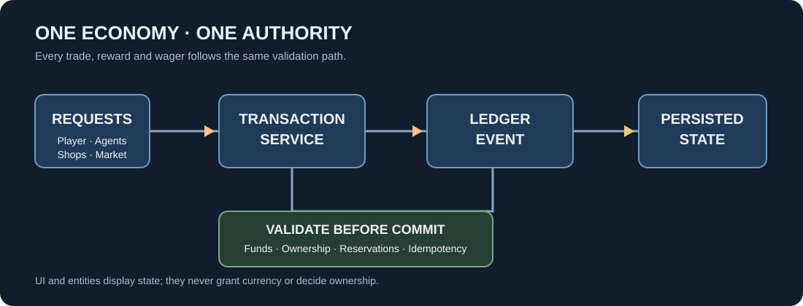

# NOSTALGIA SMP — Technical Architecture

**Status:** Proposed architecture; package/API compatibility not yet verified.

## 1. Platform and runtime

Target a Minecraft Bedrock add-on consisting of:
- Behaviour Pack for entities, components, scripts and gameplay data.
- Resource Pack for models, textures, skins, UI assets and presentation.
- TypeScript source compiled to the script format supported by the selected Bedrock Script API version.
- A version-pinned development toolchain.

The stable implementation should use supported stable APIs wherever possible. Beta-only APIs must be isolated behind an experimental adapter and must not be imported by stable gameplay modules.

### Proposed tools (verify before adoption)

- create-mc-bedrock: candidate project scaffold.
- @minecraft/server: official Bedrock Script API dependency.
- Chest-UI: candidate menu library; verify current API, licence and compatibility.
- @tendrock/database: candidate persistence library; verify package existence, licence, supported runtime, storage semantics and compatibility before adoption.

These are proposals, not confirmed dependencies. Record exact package versions and evidence in the implementation PR before installing them.

## 2. High-level modules

Proposed logical source layout:

    src/
      main.ts
      core/
        ids.ts
        clock.ts
        result.ts
        validation.ts
      economy/
        accounts.ts
        inventory.ts
        ledger.ts
        transactions.ts
        pricing.ts
      market/
        listings.ts
        offers.ts
        matching.ts
        market-simulation.ts
      agents/
        profiles.ts
        professions.ts
        schedules.ts
        decisions.ts
        presentation.ts
      offline/
        catch-up.ts
        simulation-budget.ts
      rankings/
        net-worth.ts
        market-share.ts
      features/
        shops/
        crates/
        casino/
      persistence/
        repository.ts
        schema.ts
        migrations/
        journal.ts
      ui/
        menus/
        forms/
        chat/
      entities/
        definitions/
        events/
      tests/
        unit/
        integration/
        fixtures/

This is a logical target layout, not a requirement to create empty folders for every future feature in the first commit. Implement only modules needed by the current milestone.

## 3. Authority boundaries

### Economy core — authoritative
Owns account balances, item quantities, reservations, transaction validation and committed economic history.

### Market engine
Requests transactions from the economy core. It must not directly mutate balances or inventories.

### Agent engine
Produces decisions and proposed actions. It cannot directly grant itself items or currency. All economic actions pass through the same validated transaction interface as the human player.

### UI and entities
Display state and submit requests. They are not trusted sources of balances, ownership or transaction outcomes.

### Persistence
Stores committed state and recovery information. It must expose explicit success/failure results; callers must not assume a write succeeded.

## 4. Core data model (initial proposal)

*All economic actors submit requests to one transaction service. The diagram is a design rule, not an implemented system.*

Use stable string IDs and explicit schema versions.

### Account
- id
- ownerType: player, agent, shop, house/system
- balanceMinor: integer smallest currency unit
- status
- version

Avoid floating-point currency. Display formatting belongs in the UI.

### Inventory entry
- ownerId
- itemKey
- quantity
- reservedQuantity
- Optional metadata / durability representation where supported

### Agent profile
- id
- displayName
- skinKey
- profession
- personality
- accountId
- inventoryId
- schedule
- lastSimulatedAt
- profileVersion

### Listing
- id
- sellerId
- itemKey
- quantity
- unitPriceMinor
- reservedQuantity
- status
- createdAt
- expiresAt

### Offer
- id
- listingId
- buyerId
- quantity
- unitPriceMinor
- status
- expiresAt

### Transaction
- id
- idempotencyKey
- type
- debits
- credits
- itemTransfers
- fees
- reason
- createdAt
- schemaVersion

The transaction record should explain the economic event, not merely store a balance after the fact.

## 5. Transaction processing

All transfers use one transaction service.

Required properties:
- Validate all participants and quantities before mutation.
- Validate sufficient funds and unreserved item quantities.
- Use integer currency.
- Use idempotency keys for repeatable UI/action requests.
- Do not permit negative balances or negative inventory.
- Do not permit reserved quantity to exceed owned quantity.
- Apply all related debits, credits and item transfers as one logical operation.
- Persist a recoverable commit record before reporting success.
- On failure, return a typed failure and leave state unchanged.
- Reconcile persisted state on load.

Bedrock world property APIs may not provide database-style multi-record ACID transactions. Therefore the implementation must use a deliberate journal/snapshot protocol and test crash/interruption cases. Do not describe the storage layer as fully atomic unless that property is proven.

## 6. Persistence strategy

Candidate storage:
- Dynamic Properties for compact, bounded world state if supported by the selected runtime.
- A chunked journal/snapshot format for larger state.
- External database only if the target hosting/runtime actually supports it; do not assume an add-on can open arbitrary local files or network connections.

A surfaced design reference notes a 32,767-byte limit for a saved text value. Treat this as a verification item against the exact API/property type and version, not as a universal limit for every Bedrock storage mechanism.

If storing JSON in bounded values:
- Measure UTF-8 byte length, not JavaScript character count.
- Chunk records with explicit sequence numbers and checksums.
- Store schema version and commit sequence.
- Bound history size and archive older records in a deliberate way.
- Never silently truncate the only copy of a transaction history.
- Validate chunks on load and recover from the last valid committed snapshot/journal position.

The selected persistence library must be inspected before it becomes a dependency. A library does not remove the need to define ownership, transaction invariants or migration rules.

## 7. Offline simulation engine

Use elapsed-time catch-up rather than continuous background execution.

Suggested algorithm:
1. Load and validate snapshot/journal.
2. Read last committed simulation time.
3. Clamp elapsed time to configured maximum.
4. Split elapsed time into bounded simulation ticks.
5. For each tick, process agents in stable deterministic order.
6. Enforce per-agent and global production/trade budgets.
7. Submit all economic changes through transaction service.
8. Save a new snapshot/checkpoint and simulation timestamp.
9. Ensure replay after interrupted execution cannot duplicate committed events.

Do not use unbounded loops based on real elapsed time. Define maximum catch-up duration, ticks per load and transactions per tick.

## 8. Entity presentation

The initial bot representation is a custom humanoid entity with player-style geometry/texture, a visible name and equipment presentation.

The entity is not the agent's persistent identity. The agent profile is authoritative; entities can be despawned and recreated from saved profiles.

Keep presentation concerns separate:
- Skin/texture lookup.
- Name display.
- Equipment display.
- Interaction routing.
- Optional movement and idle animation.

Do not make economic state depend on whether an entity is currently loaded.

## 9. SimulatedPlayer experiment

A separate experiment may evaluate the Bedrock SimulatedPlayer API.

Before adoption, verify:
- API availability in the exact target client and Script API version.
- Required experiments and world settings.
- Behaviour on mobile.
- World reopen/respawn lifecycle.
- Realms compatibility requirements.
- Player enumeration and filtering.
- Inventory and skin limitations.
- Whether the API is stable or beta.

The stable custom-entity implementation must continue to work if this experiment is removed.

## 10. API and dependency policy

- Pin Minecraft target version and Script API module version.
- Pin npm package versions and commit lockfile.
- Avoid floating latest versions.
- Record licences and source URLs.
- Do not copy code from All Rights Reserved projects.
- Isolate third-party UI libraries behind local adapters.
- Prefer a small dependency surface.
- Run a clean install and build in CI.
- Test the generated pack on the actual target Bedrock client.

## 11. Test strategy

### Unit tests
- Account arithmetic.
- Inventory ownership and reservations.
- Transaction validation.
- Idempotency.
- Pricing bounds.
- Agent decision constraints.
- Offline catch-up limits.
- Ranking calculations.

### Integration tests
- Player sells items to shop.
- Agent lists stock.
- Player makes offer and agent counters.
- Accepted offer transfers money and items once.
- World reload preserves balances and stock.
- Interrupted persistence recovers without duplication.
- Offline catch-up does not exceed configured production limits.

### In-client tests
- Import pack on iPhone.
- Create fresh test world with required experiments.
- Confirm pack loads without errors.
- Test menu and entity interactions.
- Close and reopen world.
- Repeat tests after each supported Minecraft update.

## 12. Security and abuse cases

Even in single-player, validate all inputs:
- Negative, zero, fractional or extreme quantities.
- Invalid item identifiers.
- Stale listing/offer IDs.
- Expired offers.
- Duplicate callbacks.
- Corrupt or partial saved data.
- Clock moved backwards or forwards.
- Agent attempting to trade reserved stock.
- Insufficient funds.
- Overflow in currency and quantity arithmetic.

Treat all UI input and persisted JSON as untrusted until validated.
